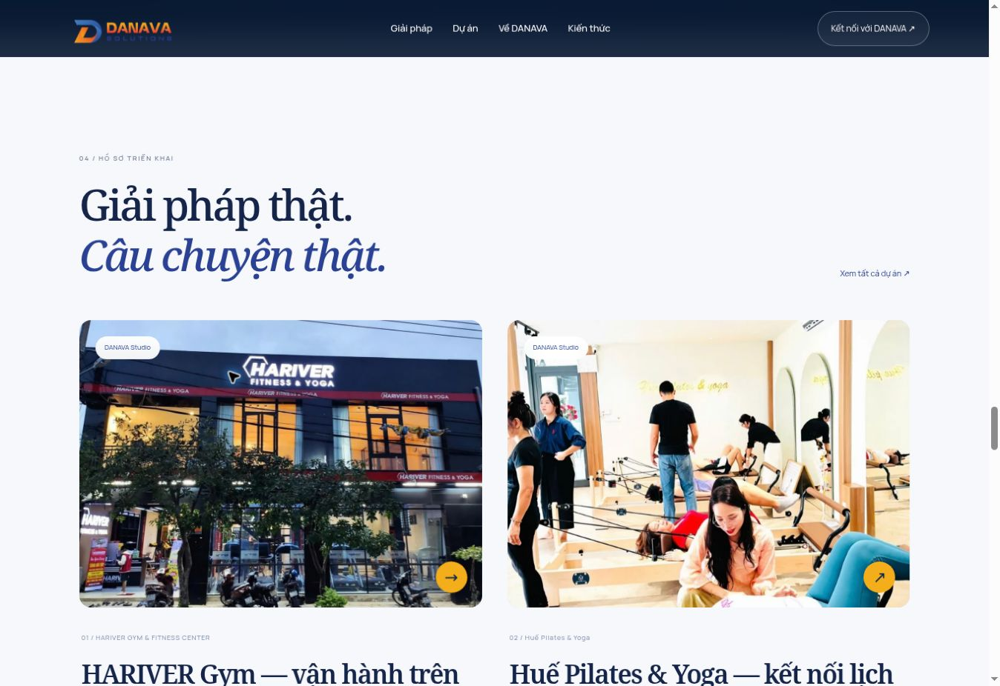

# DANAVA Solutions

Website doanh nghiệp với Next.js 16, React, TypeScript, GSAP và **backend Node.js + SQLite**. Nhận diện DANAVA: `#2B4294`, `#F5AE1B`, `#53A5DB`, `#EE3132`. Menu hòa nền đầu trang, chuyển kính xanh khi cuộn. Font Manrope / Noto Serif lưu cục bộ, có ký tự tiếng Việt; giấy phép tại `public/fonts/`.

## Chạy và kiểm tra

Yêu cầu **Node.js 24+**, ổ đĩa bền vững, một máy chủ ứng dụng. Không còn là bản export HTML trong `out/`.

```sh
npm ci
npm run check
npm test
npm run build
npm run test:integration
npm start
```

`npm run dev:next` phát triển với hot reload. `npm run dev -- --port 4173` xem bản production đã build. `npm run build` chuẩn bị cả public assets và JavaScript tĩnh cho standalone server. cPanel có thể dùng file khởi động `server.cjs` tại gốc dự án.

## Chức năng

- Trang chủ mở đầu bằng hành trình cuộn 5 cảnh; có chọn cảnh, bỏ qua và giảm chuyển động. Cảnh 2.5D bằng lớp ảnh, không phải camera 3D render như video mẫu.
- Giải pháp và 5 trang chi tiết; giới thiệu người đại diện và đội ngũ; dự án và trang dự án động; kiến thức và trang bài viết động; liên hệ qua điện thoại và email.
- `/admin/`: đăng nhập một quản trị viên bằng mật khẩu; cookie HttpOnly, SameSite Strict, CSRF, giới hạn thử đăng nhập, phiên 8 giờ, đăng xuất. Không cấu hình mật khẩu thì chức năng quản trị khóa. Đổi hash mật khẩu sẽ vô hiệu hóa phiên cũ.
- Sửa tiêu đề/mô tả, liên hệ, số liệu kinh doanh, nhân sự, dịch vụ, bài viết và dự án. Thông tin lưu trên máy chủ, áp dụng cho mọi khách truy cập sau khi tải/điều hướng lại. Có kiểm tra revision để tránh ghi đè thay đổi từ phiên khác.
- Bản nháp bài viết/dự án không nằm trong dữ liệu công khai, URL công khai trả 404. Bật xuất bản rồi lưu để hiện thẻ và trang chi tiết; chọn nổi bật để đưa dự án lên trang chủ.
- Bài viết có slug, ảnh bìa và mô tả SEO. Nội dung văn bản thuần, không thực thi HTML từ import.
- Quản trị dự án: thẻ và trang chi tiết có tên, lĩnh vực, khách hàng, ảnh, tóm tắt, bối cảnh, giải pháp và kết quả. Tải mẫu JSON trong `/admin/du-an/`, nhập mảng dự án (hoặc `{ "projects": [...] }`). Import ghép theo ID, kiểm tra trùng slug; kiểm tra xong bấm Lưu thay đổi. Dữ liệu mẫu luôn là nháp.
- Cài đặt: xuất/nhập toàn bộ nội dung JSON, giới hạn 2 MB, kiểm tra cấu trúc trước khi ghi. Import toàn bộ thay thế bộ nội dung hiện hành; xuất bản sao trước khi nhập.
- Ảnh có thể tải trực tiếp qua Thư viện ảnh hoặc trình sửa blog, dự án, nhân sự và trình chiếu. PNG/JPG/WebP tối đa 6 MB, tối đa 16 triệu pixel, chỉ ảnh tĩnh; server giải mã và chuyển WebP, bỏ metadata, cạnh dài tối đa 2400 px. Giới hạn 500 ảnh tải lên. File lưu ở `DANAVA_DATA_DIR/media`, phục vụ công khai qua URL `/assets/uploads/<uuid>.webp`; chưa có xóa ảnh để tránh làm hỏng nội dung đang dùng. Ảnh cố định cũng có thể đặt trong `public/assets/` rồi build lại. **chưa có trình soạn thảo rich text, nhiều tài khoản hay phân quyền**.

## Thống kê thực tế

`/admin/thong-ke/`: lọc 7/30/90 ngày; trình duyệt duy nhất, phiên, lượt xem, thời gian tương tác trung bình mỗi phiên, phiên hoạt động 90 giây qua, trang được xem, nguồn tên miền và biểu đồ theo ngày.

Chỉ đo khi khách đồng ý tại banner, tôn trọng Do Not Track, loại lượt đo từ quản trị viên đã đăng nhập. Mã trình duyệt ngẫu nhiên lưu ở localStorage, mã phiên theo tab ở sessionStorage; database giữ mã băm, không lưu IP hay nội dung biểu mẫu. Nguồn truy cập chỉ giữ hostname, không giữ query. Thời gian chỉ cộng khi tab hiển thị, có focus, có hoạt động trong 60 giây gần đây. Server giới hạn thời gian tăng theo thời gian thực; dữ liệu được dọn khi nhận sự kiện, giữ cửa sổ tối đa 90 ngày.

Đây là phép đo trình duyệt/phiên, không xác định người thật chính xác. Trình chặn và người từ chối không được tính; sự kiện tự động hoặc giả mạo vẫn có thể ảnh hưởng số liệu. Chưa tích hợp Google Analytics, Search Console, dữ liệu doanh thu hay app DANAVA Studio bên ngoài. Phần này đo **website hiện tại**.

## SEO

Trang xuất bản được render nội dung từ server, có URL slug riêng, title/description, canonical, Open Graph, Article/CreativeWork/Organization JSON-LD; sitemap cập nhật từ database, robots chặn admin/API. Admin có noindex. Số liệu chưa xác nhận và dự án chưa được cung cấp không được tự tạo. Đây là nền tảng kỹ thuật SEO, không phải cam kết thứ hạng. Cần kế hoạch redirect 301 từ URL WordPress cũ trước khi đổi tên miền sang bản mới.

## Triển khai cPanel Node.js

1. Sao lưu website WordPress, database và URL cũ. Triển khai trên tên miền thử trước.
2. Chọn Node.js **24+** trong Setup Node.js App. Nếu chỉ có Node cũ, nhờ hosting nâng phiên bản hoặc dùng máy chủ Node phù hợp; không upload bản này như HTML tĩnh.
3. Application Root là thư mục repository, Application Startup File là **`server.cjs`**, môi trường production. Cài dependency và chạy `npm run build`.
4. Cấu hình biến môi trường:
   - `SITE_URL`: origin HTTPS thật, không có đường dẫn, ví dụ `https://danava.com.vn`. Phải trùng origin để đăng nhập và lưu nội dung.
   - `DANAVA_DATA_DIR`: đường dẫn tuyệt đối tới thư mục lưu trữ bền vững **ngoài public web root và ngoài thư mục build**, có quyền ghi cho ứng dụng. Chứa `danava.sqlite` và các file WAL/SHM. Không đưa vào Git, không xóa khi deploy.
   - `DANAVA_ADMIN_PASSWORD_HASH`: giá trị tạo theo hướng dẫn bên dưới. Không dùng mật khẩu mẫu.
   - `PORT`: do hosting cấp; `DANAVA_HOSTNAME` tùy chọn, mặc định `0.0.0.0`.
5. Bật HTTPS/reverse proxy do hosting quản lý, giới hạn kích thước request (ví dụ 7 MB để hỗ trợ upload ảnh 6 MB) và rate limit tại proxy; khởi động lại ứng dụng. Cookie quản trị production chỉ hoạt động qua HTTPS.
6. Kiểm tra đăng nhập, tạo nháp, xuất bản dự án, sitemap và dữ liệu sau restart. Sao lưu SQLite bằng công cụ backup SQLite để nhất quán với WAL; không chỉ chép riêng file chính trong khi ứng dụng đang ghi. Sao lưu cả thư mục media khi chuyển máy chủ. JSON chỉ sao lưu nội dung và đường dẫn ảnh, không sao lưu file ảnh, thống kê hoặc phiên.

Tạo hash trên terminal riêng, nhập mật khẩu ít nhất 12 ký tự qua stdin, không ghi mật khẩu vào file hoặc câu lệnh:

```sh
read -rs -p 'Mật khẩu quản trị: ' DANAVA_INPUT
printf '%s' "$DANAVA_INPUT" | npm run --silent admin:password
unset DANAVA_INPUT
```

Sao chép **hash** in ra vào biến môi trường hosting. Không gửi mật khẩu thật trong chat hoặc commit. Khi chạy local, có thể cấu hình bằng file môi trường không được theo dõi bởi Git. Không chia sẻ một file SQLite qua nhiều máy chủ hoặc ổ mạng; bản này hướng đến một ứng dụng Node trên một host.

## Nguồn nội dung và phạm vi

- Hotline `0935917677`, email liên hệ mới `hello@danava.vn`, danh sách nhân sự và ảnh lấy từ website DANAVA công khai. Địa chỉ liên hệ mới 08 Đặng Vũ Hỷ, An Hải, Đà Nẵng được đối chiếu từ footer nền tảng danava.vn; website cũ từng ghi địa chỉ Hàn Thuyên.
- 15 ảnh gốc tối ưu WebP; `public/assets/legacy/sources.json` ghi URL. Không thay khuôn mặt bằng ảnh AI. Ảnh dịch vụ là minh họa lĩnh vực; ảnh nền kiến trúc là minh họa, không khẳng định là văn phòng DANAVA.
- 30 bài viết đã chuyển toàn văn dạng text từ bản lưu WordPress. `lib/legacy-catalog.ts` giữ tiêu đề, chuyên mục, ngày và URL nguồn; `lib/archived-posts.ts` cung cấp chỉ mục đối chiếu. Sáu bài mới nhất có ảnh đúng từ chính bài gốc. Ba URL ngắn đã có trước được giữ nguyên. Chưa di chuyển mọi landing page hoặc tính năng thương mại của WordPress.
- Mặc định có 2 hồ sơ được đối chiếu từ danava.vn: HARIVER Gym và Huế Pilates & Yoga. Mỗi hồ sơ có URL nguồn, không gán thêm số liệu kinh doanh. Không lấy case study, khách hàng, logo hay số liệu của SEODO để gán cho DANAVA. Chỉ tham khảo cách tổ chức giải pháp, bằng chứng dự án, lãnh đạo, kiến thức và CTA của https://seodo.vn/.
- Chưa triển khai bản này lên tên miền. Không tự xóa WordPress cũ hay database cPanel.

## Kiểm thử

Unit tests: nội dung, import, ảnh an toàn, trùng slug, timeline cuộn. Integration tests dùng SQLite tạm và server production riêng: đăng nhập, CSRF, xung đột revision, lưu sau restart, SSR bài/dự án mới, metadata, sitemap, bản nháp 404/không rò rỉ, font cục bộ, đếm truy cập/giới hạn thời gian/loại admin và đăng xuất. Kiểm thử tạm không ghi dữ liệu giả vào database vận hành. Cần xác nhận thực tế cấu hình Node/HTTPS/ổ đĩa trên hosting trước khi vận hành.

## Trình chiếu và hệ sinh thái (cập nhật theo ảnh chủ sở hữu cung cấp)

- Logo gốc được giữ nguyên, bỏ góc nghiêng của chữ, giới hạn kích thước phóng và đặt trên nền sáng có tương phản để đọc rõ hơn. Để tái tạo độ nét vector ở mọi kích thước cần file SVG/AI gốc.
- Cảnh Công nghệ sử dụng ảnh dashboard DANAVA Studio được cung cấp; ảnh nằm đầy đủ trong khung máy tính, có nhãn dữ liệu demo, không thay bằng số liệu đo thực tế.
- Cảnh Hệ sinh thái dùng đúng ảnh tổng quan được cung cấp. Trang chủ có 6 thẻ chữ truy cập được: DANAVA Studio, DIGITAL, E-learning, PMS, MEDIA, Go. Không tự tạo liên kết hoặc tuyên bố các sản phẩm đã sẵn sàng thương mại.
- `/admin/trinh-chieu/` sửa tiêu đề/mô tả, ảnh màn hình và ảnh hệ sinh thái, tên/mô tả/chức năng/bật tắt 6 thẻ. Dữ liệu cũ chưa có presentation được đọc với mặc định tương thích; lưu để ghi cấu hình mới. Chữ nằm trong ảnh tổng quan là nội dung raster cố định, phải thay ảnh khi cập nhật; chữ của thẻ và nhãn trình chiếu cập nhật theo dữ liệu.
- `/admin/thu-vien/` tải ảnh và sao chép đường dẫn. Chỉ tài khoản đăng nhập được tải và liệt kê, upload có kiểm tra Origin/CSRF, chữ ký file, kích thước và giải mã ảnh. Ảnh đã tải có URL công khai; không dùng thư viện này cho ảnh mật.
- Kiểm tra bổ sung: cấu trúc presentation, ảnh an toàn, tương thích import cũ, upload có xác thực/CSRF, từ chối SVG, đọc ảnh sau restart.

### Ảnh kiểm tra giao diện thực tế

Đã kiểm tra trên trình duyệt desktop: logo, chuyển cảnh Công nghệ (24%), Hệ sinh thái (72%) và cuộn ngược về mở đầu. Chưa kiểm thử trên điện thoại thật.



## Đợt nâng cấp trải nghiệm sau video rà soát

- Animation mở đầu dùng một foreground duy nhất: chữ và artwork của hai cảnh không chồng lên nhau. Chuyển cảnh có khoảng nhường cho camera/nền, nội dung có khoảng giữ rõ; giảm số tween tạo mỗi frame bằng cập nhật transform/opacity trực tiếp. Có đảo chiều, điều hướng cảnh và giảm chuyển động. Đây vẫn là phối cảnh 2.5D, không phải mô hình 3D của văn phòng thật.
- Trang chủ được thiết kế thành câu chuyện: sứ mệnh → hệ sinh thái tương tác bằng tab → giải pháp accordion → màn hình Studio → hồ sơ triển khai → người đại diện → tư liệu cộng đồng → kho kiến thức → đội ngũ → cổng kết nối. Có reveal/parallax nhẹ, nội dung server vẫn có sẵn khi chưa có JavaScript.
- Sáu mảng hệ sinh thái vẫn lấy từ dữ liệu quản trị; các nút tab có điều hướng bàn phím. Dịch vụ, dự án, bài viết, ảnh và nhân sự tiếp tục đọc dữ liệu CMS, không thay bằng mockup tĩnh.
- Dữ liệu cũ đã lưu không bị ghi đè. Tại Cài đặt, nút **Bổ sung kho nội dung DANAVA đã đối chiếu** chỉ ghép bài viết/dự án còn thiếu vào bản chỉnh sửa; kiểm tra rồi lưu. ID hoặc slug có sẵn được giữ nguyên. Thông tin email đã chỉnh trên DB cũng không tự bị đổi theo mặc định.
- Xem `docs/content-sources.md` để đối chiếu nội dung và ảnh. Không dùng các counter tổng hợp trên web cũ/mới làm kết quả kinh doanh được chứng thực; số liệu công khai vẫn do quản trị bật/tắt.

- Bổ sung 40 redirect vĩnh viễn cho URL WordPress đã biết: 30 bài và 10 trang giới thiệu/dịch vụ. Cần giữ Node xử lý request tại tên miền mới để các redirect hoạt động; các URL cũ ngoài danh sách vẫn cần rà soát riêng.
